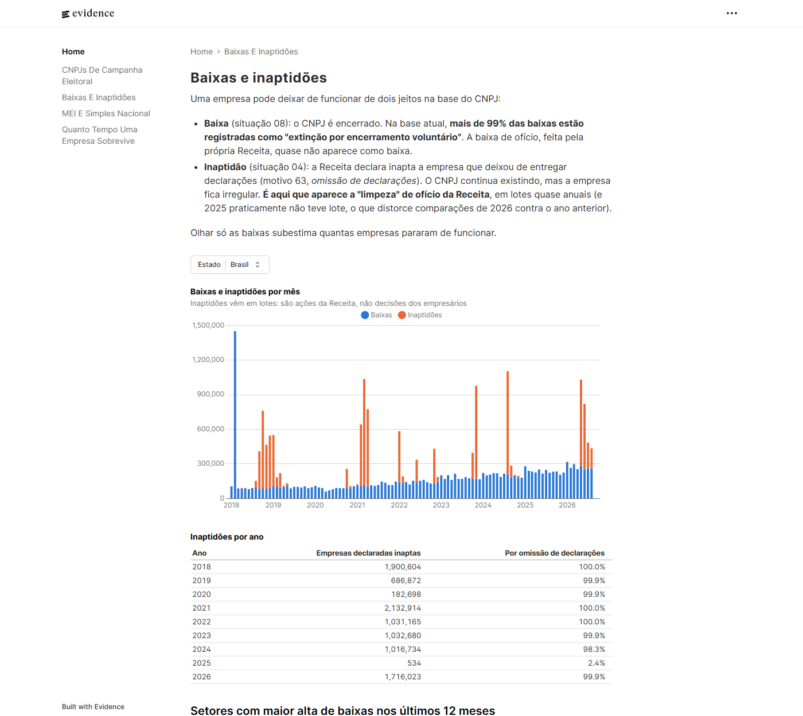
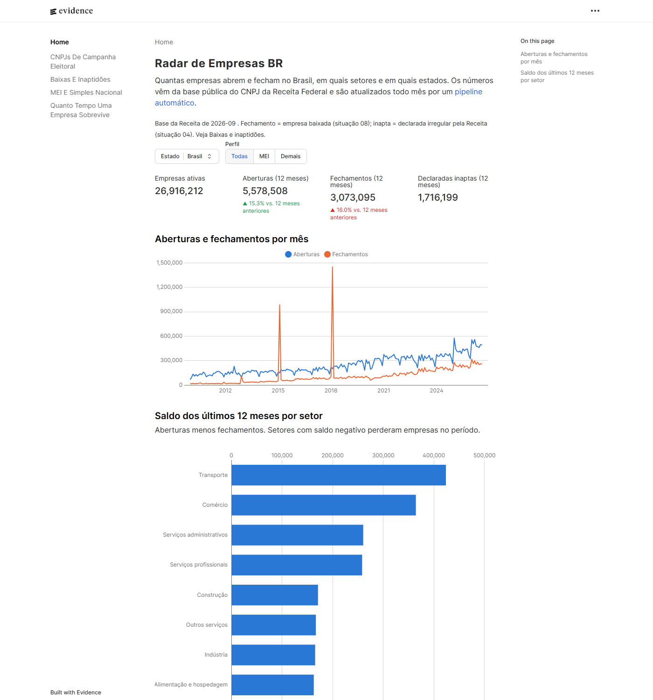
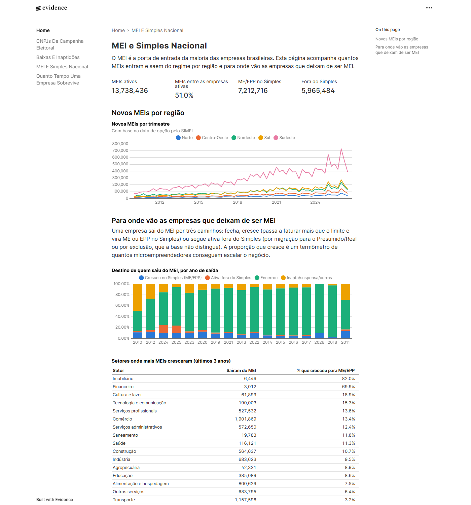
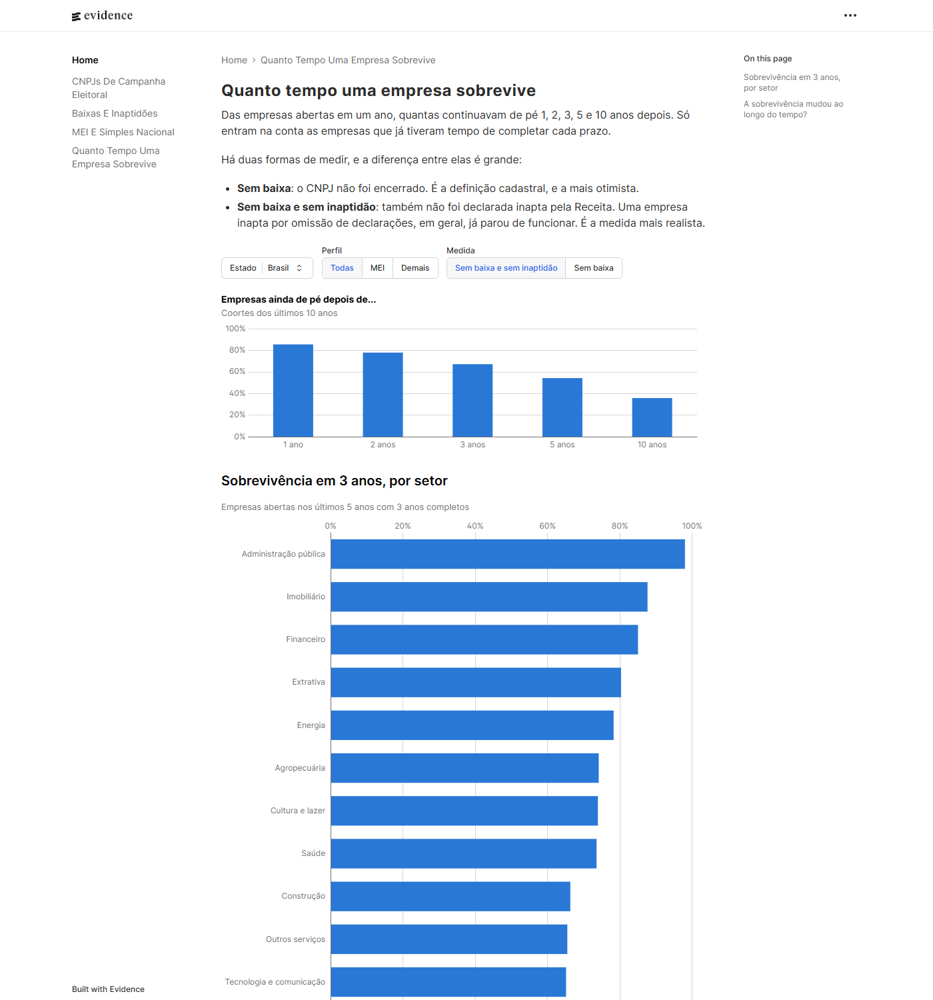
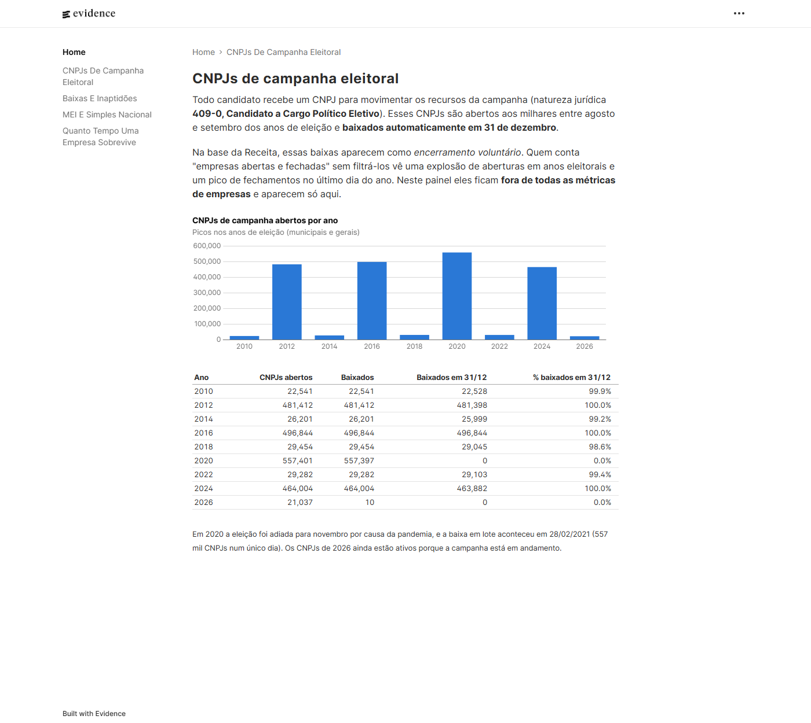
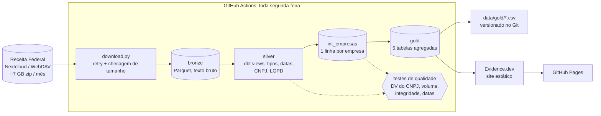

# Radar de Empresas BR

[](https://github.com/RodrigoAp727/radar-de-empresas/actions/workflows/pipeline.yml)
[](https://github.com/RodrigoAp727/radar-de-empresas/actions/workflows/ci.yml)


**Quantas empresas abrem e fecham no Brasil, em quais setores, e quanto tempo elas sobrevivem**, a partir da base pública do CNPJ da Receita Federal (73 milhões de estabelecimentos, 70 milhões de empresas e 50 milhões de registros do Simples), atualizada todo mês de forma automática.

📊 **[Abrir o dashboard](https://rodrigoap727.github.io/radar-de-empresas/)**: roda no navegador, sem instalar nada.

[](https://rodrigoap727.github.io/radar-de-empresas/fechamentos)

## O que os dados mostram

Base da Receita de setembro/2026; séries até agosto/2026. Números gerados por `python -m pipeline.achados`.

**1. A Receita declarou 1,7 milhão de empresas inaptas em quatro meses.** Normalmente são dezenas por mês. Em maio de 2026 foram 749 mil, depois 568 mil em junho, 224 mil em julho e 174 mil em agosto, 99,9% delas por **omissão de declarações**. Essas ondas acontecem quase todo ano (2,1 milhões em 2021, ~1 milhão por ano de 2022 a 2024), mas 2025 praticamente não teve nenhuma (534). Uma empresa inapta não aparece como "fechada", e por isso quem olha só as baixas não vê esse movimento.

**2. Os fechamentos mais que dobraram desde 2019.** As baixas passaram de 1,17 milhão em 2019 para 2,80 milhões em 2025. Nos últimos 12 meses foram 3,07 milhões (+16%), contra 5,58 milhões de aberturas (+15%). Entre os setores grandes, **Transporte** lidera a alta de fechamentos: +38% (de 366 mil para 504 mil).

**3. Menos da metade dos MEIs segue ativa depois de 5 anos.** São 46% sem baixa e sem inaptidão, contra 73% das demais empresas. Contando só as baixas, os MEIs pareceriam ter 63% de sobrevivência: a inaptidão esconde 16 pontos percentuais.

**4. Só 1 em cada 10 MEIs que deixam o regime cresce para ME/EPP.** Dos que saíram do MEI nos últimos 3 anos, 71% encerraram a empresa e 10% seguem no Simples como ME/EPP. O MEI é 51% das empresas ativas (13,7 milhões) e 76% das aberturas do último ano.

**5. 464 mil "baixas voluntárias" num único dia não eram empresas.** Em 31/12/2024 a base registra 463.882 baixas voluntárias. Todas são **CNPJs de campanha eleitoral** (natureza jurídica 409-0) das eleições municipais, baixados automaticamente no fim do ano. Sem esse filtro, os fechamentos dos últimos 12 meses apareceriam estáveis (-1%) quando na verdade subiram 16%.

## O dashboard

| Visão geral | MEI e Simples Nacional |
| --- | --- |
| [](https://rodrigoap727.github.io/radar-de-empresas/) | [](https://rodrigoap727.github.io/radar-de-empresas/mei) |
| **Sobrevivência** | **CNPJs de campanha eleitoral** |
| [](https://rodrigoap727.github.io/radar-de-empresas/sobrevivencia) | [](https://rodrigoap727.github.io/radar-de-empresas/eleicoes) |

## Arquitetura



| Camada | Ferramenta | O que acontece |
| --- | --- | --- |
| Ingestão | Python (`requests`) | Descobre a pasta mais recente no WebDAV da Receita e baixa um arquivo por vez, com retry e checagem de tamanho |
| Bronze | Python + DuckDB → Parquet | Zip descompactado em streaming (latin-1 → UTF-8) e gravado em Parquet, tudo como texto: nenhum valor é alterado. Linhas ilegíveis são contadas, não ignoradas em silêncio |
| Silver | dbt (views) | Tipos, datas `AAAAMMDD`, CNPJ montado, dados pessoais descartados |
| Intermediária | dbt (tabela) | Uma linha por empresa, com setor CNAE, região, regime tributário e tipo de baixa |
| Gold | dbt (tabelas) | Agregados prontos para análise: são os únicos dados publicados |
| Dashboard | Evidence.dev + GitHub Pages | Site estático reconstruído a cada carga nova |

O runner gratuito do GitHub tem pouco disco para ~30 GB de CSV. Por isso o pipeline **baixa, converte e apaga um arquivo por vez**, e só a camada gold (poucos MB) volta para o repositório.

## Decisões de negócio (onde o conhecimento contábil entra)

**1. Baixa, inaptidão e o que o motivo registrado não conta.** Cada um dos 63 motivos de situação cadastral foi classificado à mão em [`motivos_tipo_baixa.csv`](dbt/seeds/motivos_tipo_baixa.csv), com a justificativa ao lado. Exemplo: o motivo 54 (extinção com tratamento diferenciado da LC 123/2006) é a **baixa simplificada pedida pelo próprio ME/EPP**, portanto voluntária, apesar de o texto não dizer isso. Mas os dados mostraram que o motivo sozinho não basta:

- Nas baixas recentes, 98% vêm como "voluntária", e a ação de ofício da Receita aparece como **inaptidão** (situação 04). Por isso o modelo mede baixas e inaptidões separadamente.
- Baixas em massa aparecem com o motivo certo quando é cancelamento (1,37 milhão de MEIs cancelados em 01/02/2018, motivo 67), mas também com o motivo errado (os CNPJs de campanha, ver item 8).

**2. Uma foto mensal já traz a história.** A base não é um histórico de alterações: cada mês é uma fotografia completa. Mas a fotografia traz a data de abertura, a data da situação cadastral e as datas de entrada e saída do Simples e do MEI. Isso basta para reconstruir aberturas, fechamentos e sobrevivência desde 2010.

**3. Sobrevivência com censura, em duas medidas.** Uma empresa aberta há 2 anos não pode entrar na taxa de sobrevivência de 5 anos: cada horizonte só considera as coortes que já tiveram tempo de completá-lo. E "sobreviver" é medido de dois jeitos: sem baixa (definição cadastral) e sem baixa nem inaptidão (mais realista).

**4. MEI: só o último período.** A Receita guarda apenas o período de MEI mais recente de cada CNPJ. Quem entrou, saiu e voltou aparece só com as datas da volta. Por isso as séries de MEI são mais confiáveis nos anos recentes, e o dashboard avisa isso.

**5. Para onde vai quem sai do MEI.** Sair do MEI pode significar fechar, crescer (virar ME/EPP no Simples) ou seguir ativa fora do Simples. O modelo [`gold_migracao_mei`](dbt/models/gold/gold_migracao_mei.sql) separa esses caminhos. Esse último caso não é chamado de "migrou para o Presumido" porque também inclui empresas excluídas do Simples por débito, e a base não permite distinguir as duas situações.

**6. Pronto para o CNPJ alfanumérico.** A IN RFB 2.229/2024 prevê CNPJs com letras a partir de julho de 2026. O pipeline nunca converte CNPJ para número, e a validação do dígito verificador usa a regra nova (valor ASCII − 48), que vale para os dois formatos e é testada com o exemplo oficial da Receita. A base de setembro/2026 ainda não traz nenhum CNPJ alfanumérico, e o dashboard vai mostrar quando surgirem.

**7. LGPD.** Em MEIs, a razão social é o nome da pessoa física. Razão social, endereço, telefone, e-mail e a tabela de sócios ficam fora das camadas analíticas, e o dashboard só mostra agregados.

**8. CNPJs de campanha eleitoral não são empresas.** Cada candidato recebe um CNPJ (natureza 409-0) que é baixado em lote depois da eleição, normalmente em 31/12 (em 2020, com a eleição adiada pela pandemia, a baixa foi em 28/02/2021). Foram 557 mil CNPJs em 2020 e 464 mil em 2024. Eles ficam fora de todas as métricas de empresas ([`empresa_regular()`](dbt/macros/utils.sql)) e têm tabela e página próprias no dashboard.

## Qualidade de dados

Os testes rodam a cada carga (`dbt build`). Se um teste com limite de erro falha, **nada é publicado**.

| Teste | Por quê |
| --- | --- |
| Dígito verificador do CNPJ (numérico e alfanumérico) | Detecta linhas corrompidas na leitura do CSV |
| Volume mínimo de estabelecimentos | Download cortado ou zip corrompido aparece como queda de volume |
| Unicidade de CNPJ e de raiz; duplicatas na origem | Duplicata infla as contagens silenciosamente num join |
| CNAE principal existe na tabela oficial | Integridade referencial |
| Situação cadastral ∈ {01, 02, 03, 04, 08} | Detecta mudança de layout na origem |
| Baixa não pode ser anterior à abertura; abertura não pode estar no futuro | Coerência temporal |
| Motivos não classificados < 20% das baixas recentes | Avisa se a Receita criar motivos novos |

Os testes têm **limites de aviso e de erro separados**. A base oficial tem inconsistências históricas conhecidas: um punhado delas gera aviso, e um volume anormal interrompe a publicação.

**O que os testes já encontraram na base real (setembro/2026):**

- **Todos os 73,4 milhões de CNPJs têm dígito verificador válido**, e nenhuma das ~194 milhões de linhas foi rejeitada na leitura.
- **Uma raiz de CNPJ aparece duplicada** na tabela de Empresas, com uma das cópias vazia (natureza jurídica 0000, porte nulo). O join multiplicou a empresa, e o teste de unicidade **barrou a publicação**. A silver agora fica com o registro mais completo, e um teste separado continua avisando sobre duplicatas na origem.
- **33 empresas têm data de baixa anterior à data de abertura**. É uma inconsistência da origem, registrada como aviso.
- A parte 0 de Estabelecimentos tem **campos com quebra de linha entre aspas** e **bytes que o leitor latin-1 do DuckDB recusa**. Por isso a conversão para UTF-8 é feita em Python, em streaming.

## Testes de software

Além dos testes de dados, o código tem testes automatizados que rodam no [CI](.github/workflows/ci.yml) a cada push:

- **Testes unitários do dbt** ([`_unit_tests.yml`](dbt/models/gold/_unit_tests.yml)): entradas fixas e saída esperada para as regras mais fáceis de errar, que são a censura na taxa de sobrevivência, o destino de quem sai do MEI e a separação entre baixa voluntária e baixa de ofício.
- **Teste da própria regra do CNPJ**: casos conhecidos, incluindo o exemplo oficial da Receita para o formato alfanumérico (`12.ABC.345/01DE-35`), em [`cnpjs_exemplo.csv`](dbt/seeds/cnpjs_exemplo.csv).
- **Teste ponta a ponta** ([`test_ponta_a_ponta.py`](tests/test_ponta_a_ponta.py)): gera zips sintéticos no formato exato da Receita (latin-1, quebra de linha entre aspas, CNPJ alfanumérico, raiz duplicada) e roda bronze + `dbt build` completo, em ~20 segundos.
- Lint com `ruff`.

## Como rodar localmente

Requisitos: Python 3.11+, Node 20+ e ~40 GB livres para a carga completa.

```bash
python -m venv .venv && .venv/Scripts/activate      # Linux/Mac: source .venv/bin/activate
pip install -r requirements-dev.txt

pytest                              # testes (inclui o pipeline ponta a ponta em dados sintéticos)
python -m pipeline.run --amostra    # 1 de 10 partes, ~10 min: testa o código, NÃO serve para análise*
python -m pipeline.run              # carga completa
python -m pipeline.achados          # números-manchete (use --uf SP para um estado)

cd dashboard && npm install && npm run sources && npm run dev
```

Com pouca RAM, limite o DuckDB: `RADAR_MEMORY_LIMIT=4GB RADAR_THREADS=1` (a carga completa roda num notebook com 8 GB; o excedente vai para o disco).

\* A Receita divide os arquivos por faixa de CNPJ, e todas as empresas abertas desde 2022 estão na parte 0. A amostra usa a parte 1, que só tem empresas mais antigas.

## Estrutura

```text
pipeline/          download, bronze, exportação da gold, achados
dbt/
  models/silver/   limpeza e tipagem (views)
  models/intermediate/  int_empresas (1 linha por empresa)
  models/gold/     tabelas publicadas
  seeds/           CNAE → seção, UF → região, motivo → tipo de baixa, CNPJs de teste
  tests/           testes de qualidade de dados customizados
tests/             pytest: unidade + ponta a ponta com dados sintéticos
dashboard/         Evidence.dev (páginas em Markdown + SQL)
data/gold/         CSVs publicados a cada carga
.github/workflows/ CI, pipeline mensal e deploy do dashboard
```

## Fonte e limitações

- Dados: [Cadastro Nacional da Pessoa Jurídica, Receita Federal](https://www.gov.br/receitafederal/pt-br/acesso-a-informacao/dados-abertos) (dados abertos, atualização mensal).
- "Abertura" é a data de início de atividade da matriz; filiais não entram nas contagens.
- "Fechamento" é a baixa (situação 08). Empresas inaptas ou suspensas não contam como fechadas.
- O mês da carga fica fora das séries, porque ainda está incompleto.

---

Feito por **Rodrigo Campos**: engenharia e análise de dados aplicadas ao fiscal e tributário, com a vivência da rotina fiscal de mais de 300 empresas. [LinkedIn](https://www.linkedin.com/in/rodrigo-aparecido-397a0b154/)
